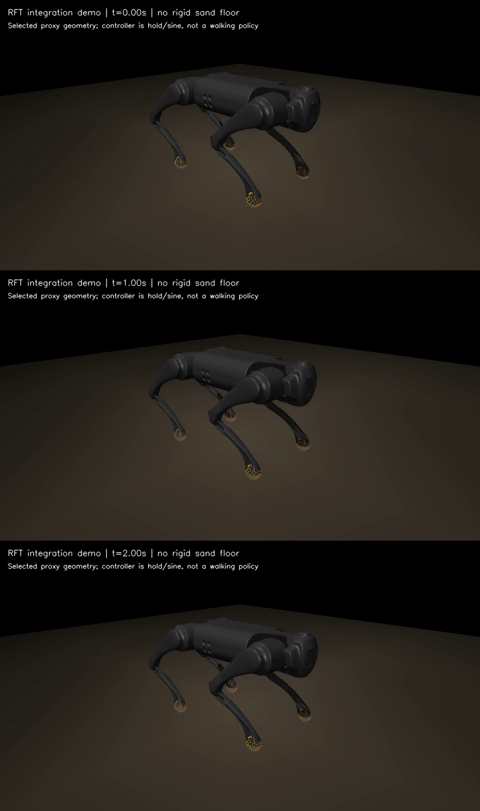
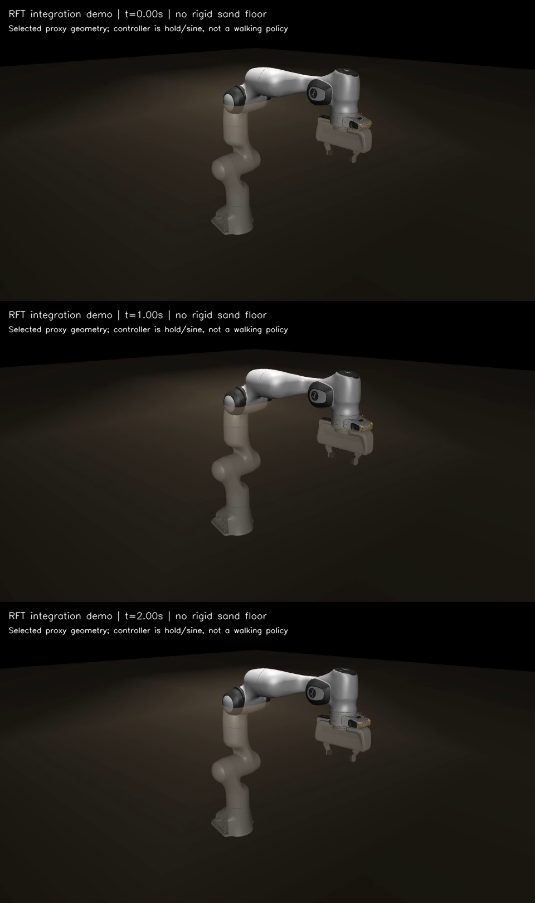

# General RFT stage-one integration demos

These two short, reviewed videos demonstrate model import, selected surface
binding, active RFT, independent control and rendering. They are not optimized
walking policies, experimentally calibrated sand models or replacements for
the lizard regression. Only configured parts receive RFT.

Clean implementation source:
`3be21dfc68218528b5d936868b91ff2fa33e2e1f` (`git.dirty=false`).
Upstream Menagerie model commit:
`f3b6013629c7b94f8ee93fd977b161fa8350f9bc`.

- [Go1 integration MP4](go1_rft_integration.mp4): holds upstream home actuator
  commands, four foot-sphere surfaces / 896 triangles; 3,999 RFT-active steps.
- [Panda integration MP4](panda_rft_integration.mp4): fixed-base arm, one
  actuator has a 0.05 rad / 0.5 Hz sine; selected link7 mesh / 200 triangles;
  2,778 RFT-active steps. Test sand height is explicitly chosen 15 mm above
  the selected surface's initial lowest centroid.

Both simulate 2 s / 4,000 steps at 0.5 ms, produce 41 frames at 20 FPS
(2.05 encoded seconds including the final frame), and remain finite. The
displayed plane is rendering-only; no rigid floor supports these demos.
No per-triangle force sites were added. All displayed orange points are the
configured triangle centroids, not hardware force sensors.





## Reproduce and inspect

Follow [the general RFT guide](../../GENERAL_RFT_GUIDE.md). Raw clean runs:

```text
outputs/general_rft/go1_clean_3be21df/
outputs/general_rft/panda_clean_3be21df/
```

The MP4s and preview PNGs are byte-for-byte copies of those verified runs,
without transcoding. Summaries, source hashes, artifact index and the final
verification log are under
[`docs/regressions/2026-10-27-general-rft`](../../regressions/2026-10-27-general-rft/).

## Upstream notices

Models are from [MuJoCo Menagerie](https://github.com/google-deepmind/mujoco_menagerie).
Go1's BSD-3-Clause notice is retained in [LICENSE-go1.txt](LICENSE-go1.txt).
Panda's Apache-2.0 notice is retained in [LICENSE-panda.txt](LICENSE-panda.txt).
Original model descriptions/licenses are preserved by the pinned installer.
The complete robot assets are not bundled into this media set.

## Exact media and license identifiers

| File | Bytes | SHA-256 |
| --- | ---: | --- |
| `go1_contact_sheet.png` | 453,717 | `db53c274d2cb1afa10ab71dfc0cffa0af3a510628cac7a7143bc52f00a9f8c12` |
| `go1_rft_integration.mp4` | 53,219 | `00815b40fd0bbb53dfdb9868b867f84a69c34c2cee4820b8da6de0dd4717cec1` |
| `LICENSE-go1.txt` | 1,559 | `2b794acf1e250f5545ae5a47d81e5685ea5488ce077d1087ed8be5f81e9ba5c0` |
| `LICENSE-panda.txt` | 10,173 | `a6cba85bc92e0cff7a450b1d873c0eaa2e9fc96bf472df0247a26bec77bf3ff9` |
| `panda_contact_sheet.png` | 411,388 | `f8da7a7e5a8b813ecc5fff5cd3ab01835fcf705be558a3643d0e460db33b29f2` |
| `panda_rft_integration.mp4` | 45,104 | `24bba2163085f38ef883c695c5e274dfd12aad067bf4b49d48ca937296104fd2` |
