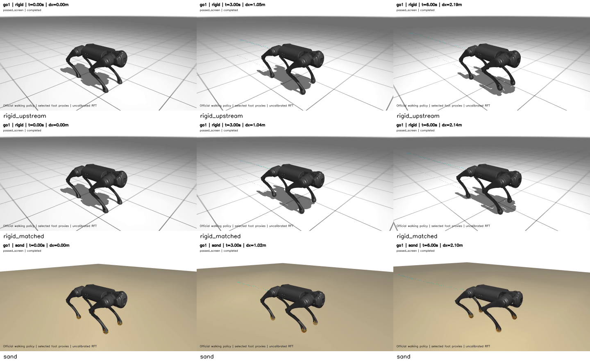
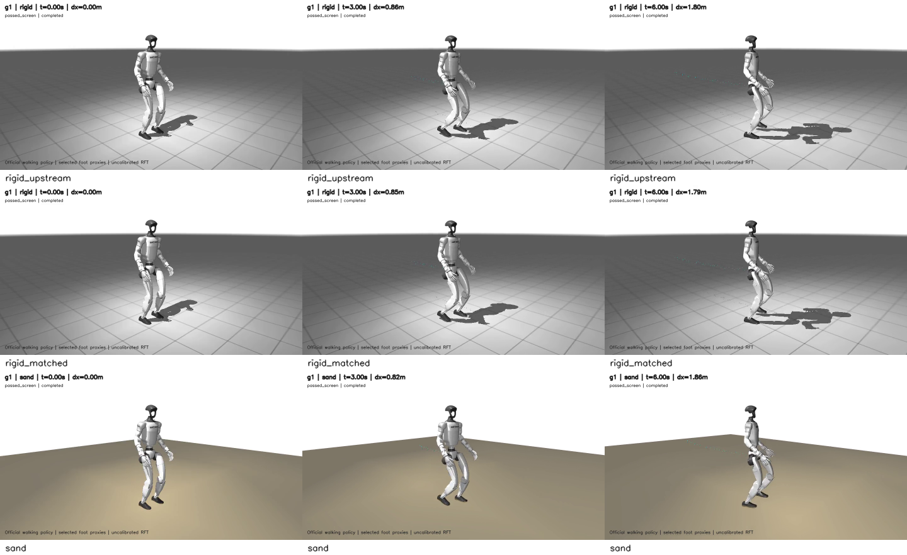
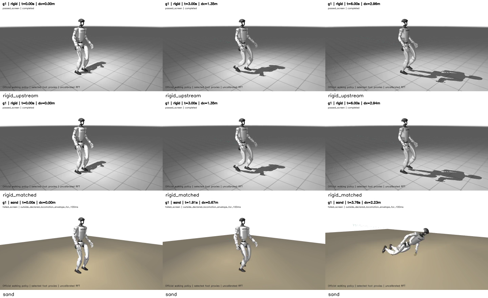

# Ground locomotion: pipeline demos and retained failure

Official pinned Go1/G1 walking policies, not hold/sine arm motion. Models
use selected remeshed **foot collision proxies**, not automatic whole-robot
CAD exteriors. RFT remains uncalibrated. Completion is a bounded screen, not
accurate tracking or a universal locomotion guarantee.

| Robot / command | Matched rigid | RFT sand | Interpretation |
| --- | --- | --- | --- |
| Go1 vx=0.4 m/s | [6 s video](go1_rigid_6s.mp4) | [6 s video](go1_sand_6s.mp4) | Completed: sand dx 2.104 m, dy +0.322 m, depth 31.00 mm |
| G1 vx=0.2 m/s | [6 s video](g1_slow_rigid_6s.mp4) | [6 s video](g1_slow_sand_6s.mp4) | Completed: sand dx 1.861 m, dy +0.003 m, depth 30.31 mm |
| G1 vx=0.4 m/s | passed 6 s, raw retained | [failed run](g1_fast_sand_failure.mp4) | Stopped at 3.765 s by posture/height guard; not a success |

All sand cases had **zero supporting rigid contact/force**. G1's two explicit
floor pairs were removed in a verified private model; three self-contact
pairs remain. Floor masks are zero. Sand-plane/orange centroid rendering is
visual only; orange dots are not sensors. Cyan points show COM history.

Command is not actual mean speed: sand Go1 0.351 vs 0.4 m/s; G1 slow 0.310 vs
0.2 m/s. G1 overshoots on rigid ground too. Detailed telemetry, contact diagrams,
hashes and failure: [evidence](../../regressions/2026-10-28-ground-rft/README.md).

## First / middle / last frames

Rows: upstream rigid, matched-timestep rigid, sand. Failure-row frames use
its shortened recorded interval, not fabricated six-second states.

## Source and integrity

Runtime `f4c0360fdcddb30e8a4e833ec8a03a34119d93ee`; fast failure
`5078fdc83d418f329bd7d54d0272fb9aaa4fb8f6`. All simulation source is clean.
Raw roots: `../../regressions/2026-10-28-ground-rft/review.json`.
Videos are exact copies without transcoding. Successful videos: 121 frames,
20 FPS, encoded 6.05 s including final frame. Failure: 76 frames / 3.80 s
for its 3.765 s simulation. Exact bytes/SHA-256: [manifest](manifest.json).

Models/assets: Menagerie `f3b6013629c7b94f8ee93fd977b161fa8350f9bc`;
policies/model XML: Playground `12ad7f3842791ced39f27e5ac96d066bbe361653`.
Original notices: [Go1 BSD](LICENSE-go1.txt), [G1 BSD](LICENSE-g1.txt),
[Playground Apache-2.0](LICENSE-playground.txt). Derivative controller code
retains Apache-2.0 in `controllers/NOTICE.playground`.

[Fresh-system deployment / run / extraction guide](../../GROUND_RFT_GUIDE.md).
