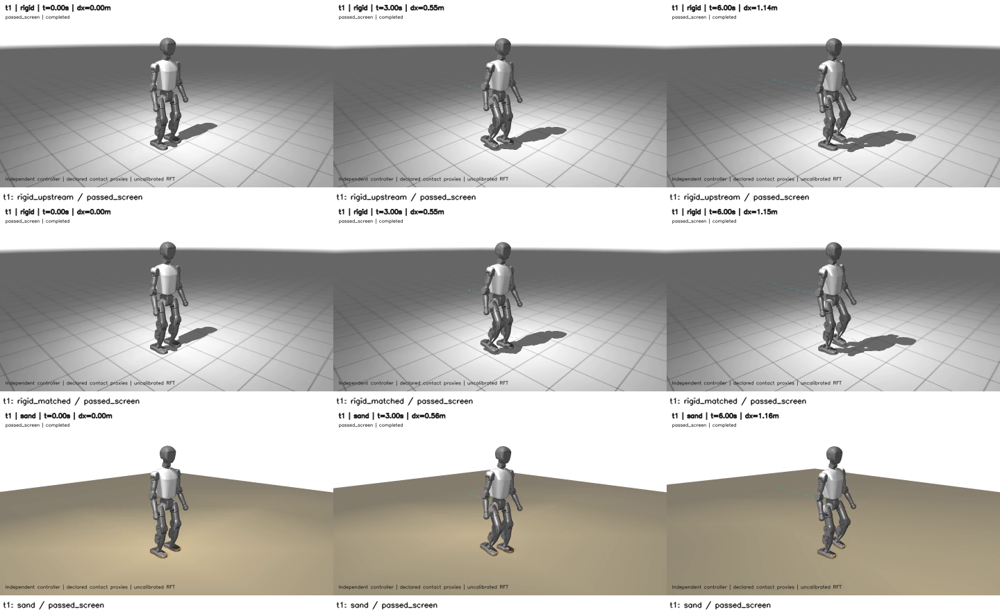
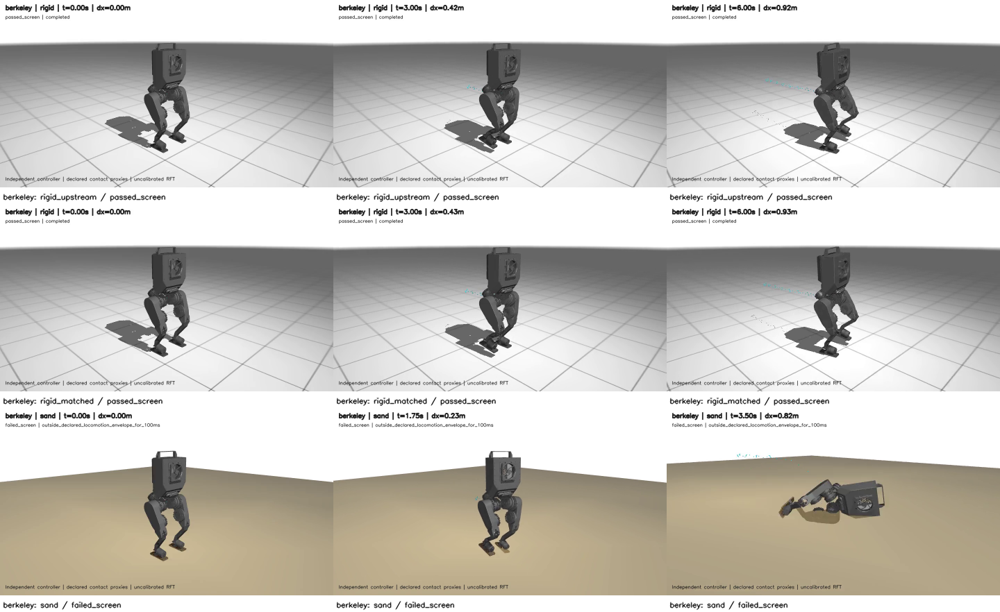
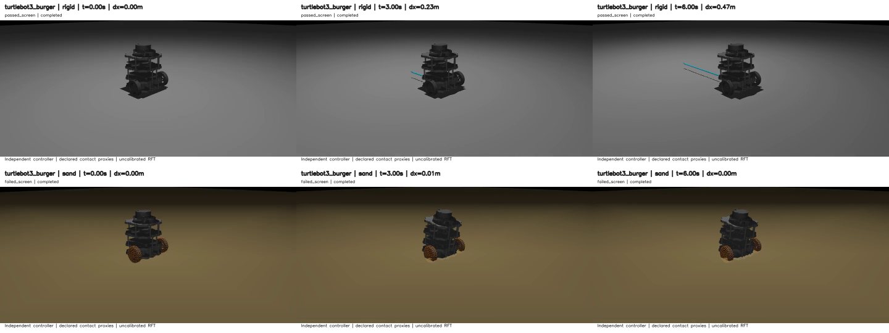

# Reviewed catalog videos

Six bounded MP4s; no failed trajectory is padded. Native policy/proxy transfer is not universally successful.

- [t1_rigid_matched.mp4](t1_rigid_matched.mp4): passed_screen, simulated 6.0000 s, dx 1.1502 m; SHA-256 `2e02bbd0500567debf577a76f7399264eaceb9354df01af1b24bdbc393f0fc7e`.
- [t1_sand.mp4](t1_sand.mp4): passed_screen, simulated 6.0000 s, dx 1.1623 m; SHA-256 `cfa170fb54a0c17d513e11320798b7921c62b8cef897fab3cd042088d0439026`.
- [berkeley_sand.mp4](berkeley_sand.mp4): failed_screen, simulated 3.4975 s, dx 0.8244 m; SHA-256 `950ecc086035a2ffb38e7a21553592d5e5e8fdf5018a965a99ec4679bfda69eb`.
- [apollo_sand.mp4](apollo_sand.mp4): failed_screen, simulated 2.3250 s, dx -0.8784 m; SHA-256 `dc0cd87809d4ee582f915426f31f69d63f904ab6825ac76fac7528b01ed13580`.
- [turtlebot3_burger_rigid_matched.mp4](turtlebot3_burger_rigid_matched.mp4): passed_screen, simulated 6.0000 s, dx 0.4687 m; SHA-256 `65cc7f630c0d7b45a6aeb340d666f26d30a834e91f1f92de40d96163501ea194`.
- [turtlebot3_burger_sand.mp4](turtlebot3_burger_sand.mp4): failed_screen, simulated 6.0000 s, dx 0.0031 m; SHA-256 `23752a4e79d0fe0faeca5b47443a78a25d624cce1e58d9a575b571d1b099fea1`.

T1, Berkeley and Apollo videos are byte-for-byte copies of clean 36659ca simulation outputs. Burger replays the same saved states with original visual meshes visible and readable caption bands; physics unchanged, separate provenance retained.

[Metrics, tests, contact diagrams and source records](../../regressions/2026-10-28-robot-catalog/README.md). Original model/policy licenses and controller notice accompany these videos. Existing Go1/G1/lizard videos remain unchanged.

