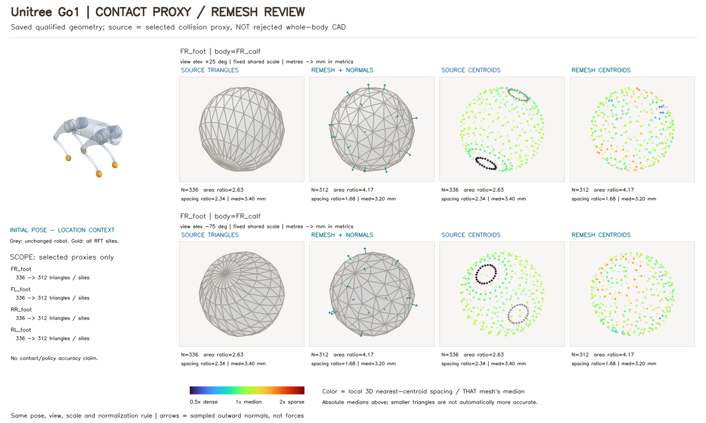
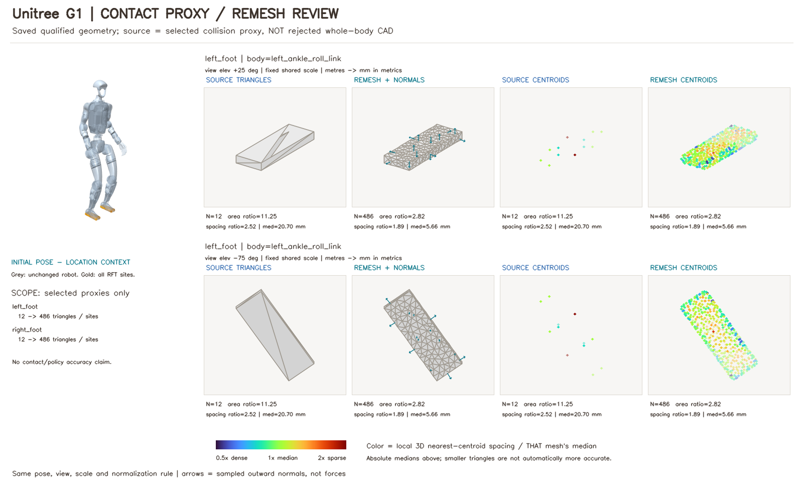
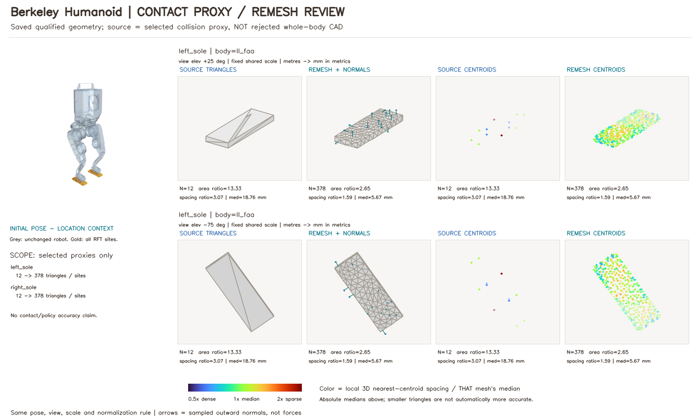
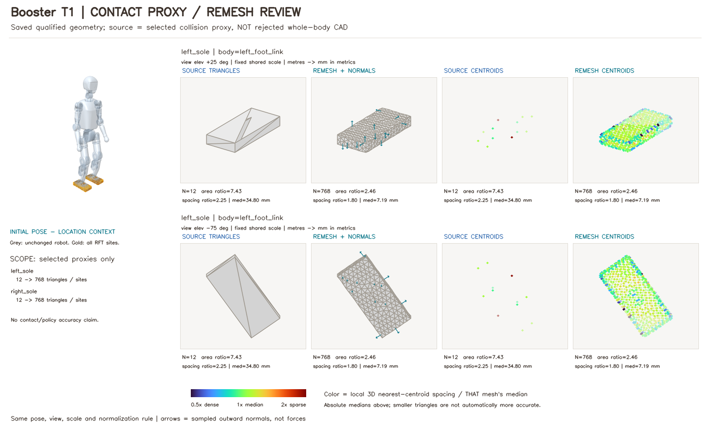
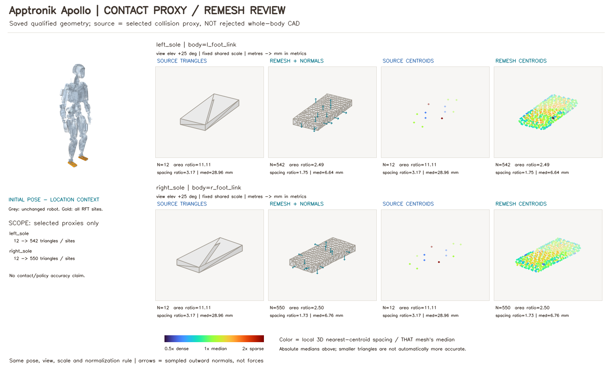
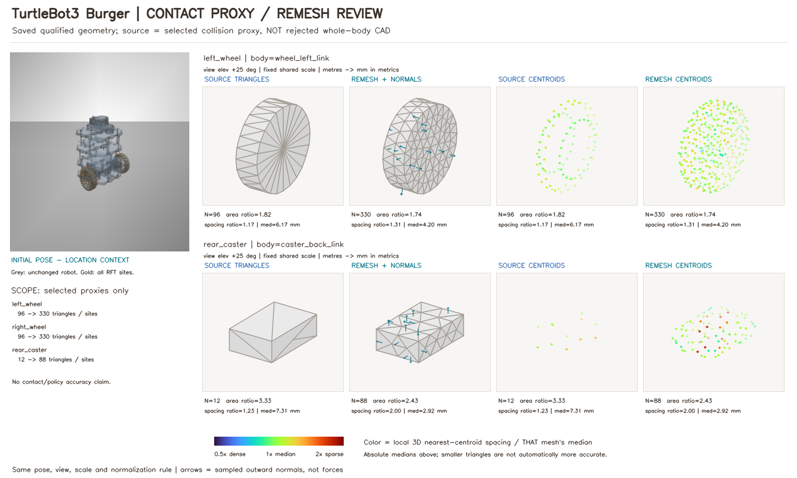
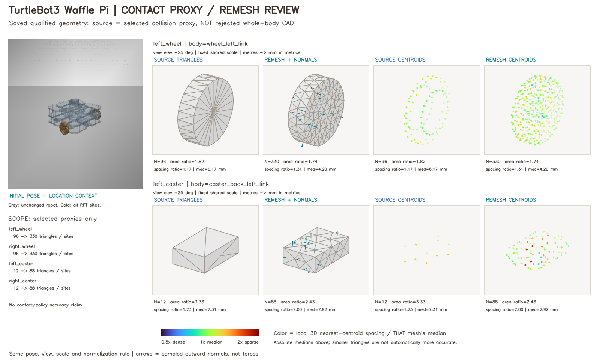

# Rigid above / sand below, plus enlarged contact-proxy remesh reviews

All movies reuse saved physics. Geometry source is the selected contact proxy, not the whole robot CAD. No missing failure motion is fabricated; early-stop scene rows become labelled no-data cards.

Motion right panels show mass-weighted COM displacement, current overlap/centroid depth and component 0/1 contact. Rigid overlap and RFT centroid penetration are different explicitly labelled quantities. Contact display conservatively ORs each time-pixel bin; full raw telemetry remains unchanged.

## Unitree Go1

[Rigid/sand MP4 - download/open](go1/motion_comparison.mp4) | [Rotating mesh/point MP4 - download/open](go1/remesh_comparison.mp4)

Individual proxy enlargements:

- [FR_foot: FR_calf](go1/proxy_FR_foot.png)
- [FL_foot: FL_calf](go1/proxy_FL_foot.png)
- [RR_foot: RR_calf](go1/proxy_RR_foot.png)
- [RL_foot: RL_calf](go1/proxy_RL_foot.png)

[Exact metrics CSV](go1/proxy_metrics.csv) | [Hashes and provenance](go1/comparison.json)

## Unitree G1

[Rigid/sand MP4 - download/open](g1/motion_comparison.mp4) | [Rotating mesh/point MP4 - download/open](g1/remesh_comparison.mp4)

Individual proxy enlargements:

- [left_foot: left_ankle_roll_link](g1/proxy_left_foot.png)
- [right_foot: right_ankle_roll_link](g1/proxy_right_foot.png)

[Exact metrics CSV](g1/proxy_metrics.csv) | [Hashes and provenance](g1/comparison.json)

## Berkeley Humanoid

[Rigid/sand MP4 - download/open](berkeley/motion_comparison.mp4) | [Rotating mesh/point MP4 - download/open](berkeley/remesh_comparison.mp4)

Individual proxy enlargements:

- [left_sole: ll_faa](berkeley/proxy_left_sole.png)
- [right_sole: lr_faa](berkeley/proxy_right_sole.png)

[Exact metrics CSV](berkeley/proxy_metrics.csv) | [Hashes and provenance](berkeley/comparison.json)

## Booster T1

[Rigid/sand MP4 - download/open](t1/motion_comparison.mp4) | [Rotating mesh/point MP4 - download/open](t1/remesh_comparison.mp4)

Individual proxy enlargements:

- [left_sole: left_foot_link](t1/proxy_left_sole.png)
- [right_sole: right_foot_link](t1/proxy_right_sole.png)

[Exact metrics CSV](t1/proxy_metrics.csv) | [Hashes and provenance](t1/comparison.json)

## Apptronik Apollo

[Rigid/sand MP4 - download/open](apollo/motion_comparison.mp4) | [Rotating mesh/point MP4 - download/open](apollo/remesh_comparison.mp4)

Individual proxy enlargements:

- [left_sole: l_foot_link](apollo/proxy_left_sole.png)
- [right_sole: r_foot_link](apollo/proxy_right_sole.png)

[Exact metrics CSV](apollo/proxy_metrics.csv) | [Hashes and provenance](apollo/comparison.json)

## TurtleBot3 Burger

[Rigid/sand MP4 - download/open](turtlebot3_burger/motion_comparison.mp4) | [Rotating mesh/point MP4 - download/open](turtlebot3_burger/remesh_comparison.mp4)

Individual proxy enlargements:

- [left_wheel: wheel_left_link](turtlebot3_burger/proxy_left_wheel.png)
- [right_wheel: wheel_right_link](turtlebot3_burger/proxy_right_wheel.png)
- [rear_caster: caster_back_link](turtlebot3_burger/proxy_rear_caster.png)

[Exact metrics CSV](turtlebot3_burger/proxy_metrics.csv) | [Hashes and provenance](turtlebot3_burger/comparison.json)

## TurtleBot3 Waffle Pi

[Rigid/sand MP4 - download/open](turtlebot3_waffle_pi/motion_comparison.mp4) | [Rotating mesh/point MP4 - download/open](turtlebot3_waffle_pi/remesh_comparison.mp4)

Individual proxy enlargements:

- [left_wheel: wheel_left_link](turtlebot3_waffle_pi/proxy_left_wheel.png)
- [right_wheel: wheel_right_link](turtlebot3_waffle_pi/proxy_right_wheel.png)
- [left_caster: caster_back_left_link](turtlebot3_waffle_pi/proxy_left_caster.png)
- [right_caster: caster_back_right_link](turtlebot3_waffle_pi/proxy_right_caster.png)

[Exact metrics CSV](turtlebot3_waffle_pi/proxy_metrics.csv) | [Hashes and provenance](turtlebot3_waffle_pi/comparison.json)

## G1 faster-command negative control

[Rigid/sand comparison](g1_fast_failure/motion_comparison.mp4). Same proxy review as G1 above; different command. Do not count this as an eighth robot.

## Interpretation and reproduction

Before/after clouds use one centroid per triangle, including all shell faces (not only active contact). Colors mean local 3D spacing divided by that mesh's own median: 0.5x dense, 1x median, 2x sparse. Absolute median spacing and actual counts are reported separately. Same camera/scale is used within each comparison. Sample arrows show outward normals, not force vectors. Source proxies can already be valid; remeshing is not proof of calibrated physics or improved walking. Whole-model images are pose-only ghost/location context; native geometry is unchanged.

Matched means controller and timestep, not identical native/RFT contact discretization. For example T1 uses original corner spheres on rigid ground and the explicitly selected sole-box RFT proxy. Read each saved geometry_status in comparison.json. GitHub MP4 file pages may show only Download/View raw; downloaded MP4s and inline chat embeds are the intended playback routes.

Raw generator: `scripts/generate_robot_comparisons.py --batch outputs/robot_catalog/clean_6s_36659ca --fast-run outputs/ground_rft/g1_clean_6s_5078fdc --output-dir outputs/robot_comparisons/NEW_RUN`. Use `conda run -n lizard_rft python` before that script. See `docs/ROBOT_COMPARISONS_2026-10-28.md` for decisions, test commands, exact evidence and boundaries. Licenses/notices accompany each robot. Prior media remains untouched.
