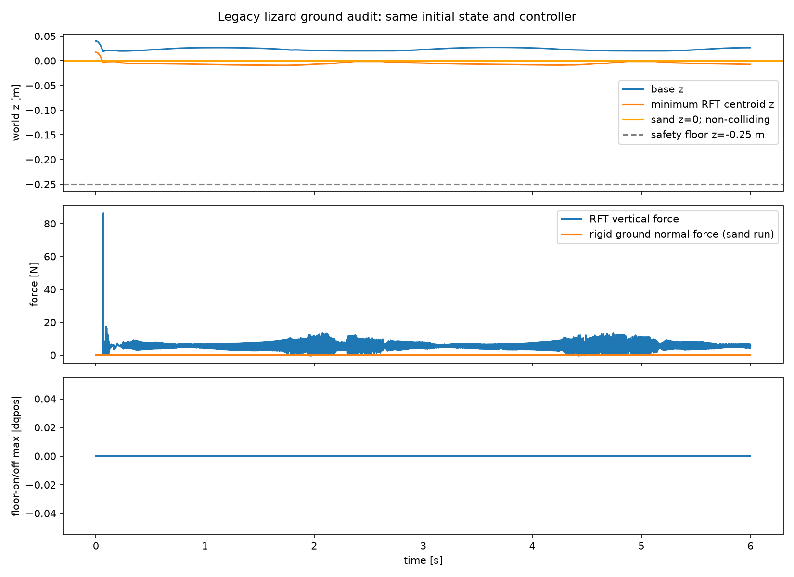
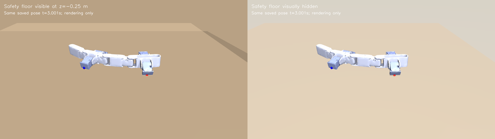

# General RFT stage-one evidence — 2026-10-27

Implementation: `3be21dfc68218528b5d936868b91ff2fa33e2e1f`.
Preserved lizard control: `ccc694677461012d488cb5ad7d7e9db945b74a80`.
The final documentation/media commit does not change tested runtime code.

## Results

| Check | Measured result |
| --- | --- |
| Unit suite | 29/29, including 13 new generic binding/provider checks |
| Full canonical validator | Passed; eight mesh gates, 13,916 sites, rigid smoke and original 6 s RFT |
| Same-state compatibility | 17 representative fixtures / 13,916 triangles, all passed |
| Maximum raw triangle-force difference | 5.551115123125783e-17 N |
| Maximum smoothed triangle-force difference | 2.7755575615628914e-17 N |
| Maximum generalized-force component difference | 8.881784197001252e-16 (N or N m by DOF) |
| Legacy active-mask disagreements | 0 |
| Final-source frozen-fixture replay | Passed, same maximum differences |
| Corrected body-frame convention | Deliberately different: max sampled triangle change 0.18259551746171374 N; generalized component change 4.357166440537851 |
| Sand-run rigid-ground support | 0 steps / 0 N over 12,000 steps |
| Safety-floor disabled control | qpos arrays exactly equal over all 12,000 steps |
| Lowest RFT triangle centroid | -9.31106929157266 mm; safety plane at -250 mm |
| Original rigid-ground minimum contact distance | -0.5747163213678276 mm; intended plane z=0 |
| Reporting compatibility | Nine individual MP4s + overview; analyzer/hash checks passed |
| External models | Go1 and Panda loaded, bound, force-producing, stepped and rendered |
| Existing environment package changes | None; only four optional pure-Python registry packages added |

Compatibility is not physical calibration. The corrected convention has
independent frame/plane/Jacobian tests but is not silently adopted by the
legacy lizard. The external examples are two-second integration screens with
selected collision proxies and hold/sine commands, not new walking policies.

## Files and interpretation

- `same_state_and_floor_summary.json`: actual six-second paired audit. This
  initial audit ran during implementation (`git.dirty=true`); its legacy
  source hashes and raw oracle arrays were preserved.
- `final_source_replay.json`: clean implementation `3be21df` re-evaluated
  those frozen force fixtures; no gait was resimulated for this replay.
  Active history is reconstructed algebraically from the oracle outputs.
- `source_files.json`: exact implementation/config/test and legacy SHA-256.
- `go1_summary.json`, `panda_summary.json`: independent clean-source demos.
- `reporting_smoke.json`: clean-source configuration, source and video count.
- `final_verification.log`: complete final command output, including the
  unchanged legacy 217.7 mm / -120.8 mm displacement and dissipative-power
  diagnostics. This is machine evidence; use portable commands in the guide.
- `artifact_index.json`: exact raw paths, sizes and SHA-256 for each run and
  the reviewed media. Raw NPZ/video data is retained locally under ignored
  `outputs/general_rft/`; it is not silently deleted or claimed tracked.

The source hash comparison confirmed that the simulation/model/gait files
used for the existing production video at `ff1dda2` are unchanged in the
preserved `ccc6946` control. The ground audit therefore addresses that current
video-matrix model/configuration, not the recovered historical invalid mesh
recording, whose physics cannot be inferred from its frames.

## Ground evidence

The latter changes rendering only. The translucent sand geom and thin visual
`sand_height` box may show the lower plane/background. No supporting sand
surface rigid contact occurred. We did not remove the legacy safety floor or
retune forces to change perceived sinkage.

## Reproduction and scope

See [GENERAL_RFT_GUIDE.md](../../GENERAL_RFT_GUIDE.md) for exact installation,
config and command examples and
[the worklog](../../RFT_GENERALIZATION_WORKLOG_2026-10-27.md) for step purpose,
failures, corrections and remaining work. All native checks ran in the
existing Windows `lizard_rft` environment using ordinary `conda run`.
No fresh environment or Linux/macOS execution is claimed. No IsaacLab state
was modified. Stock `robot_descriptions` automatic model cloning was not used.
